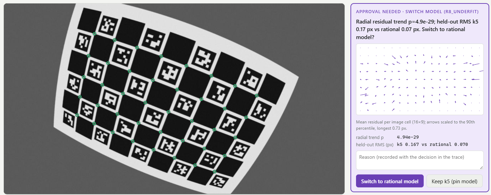
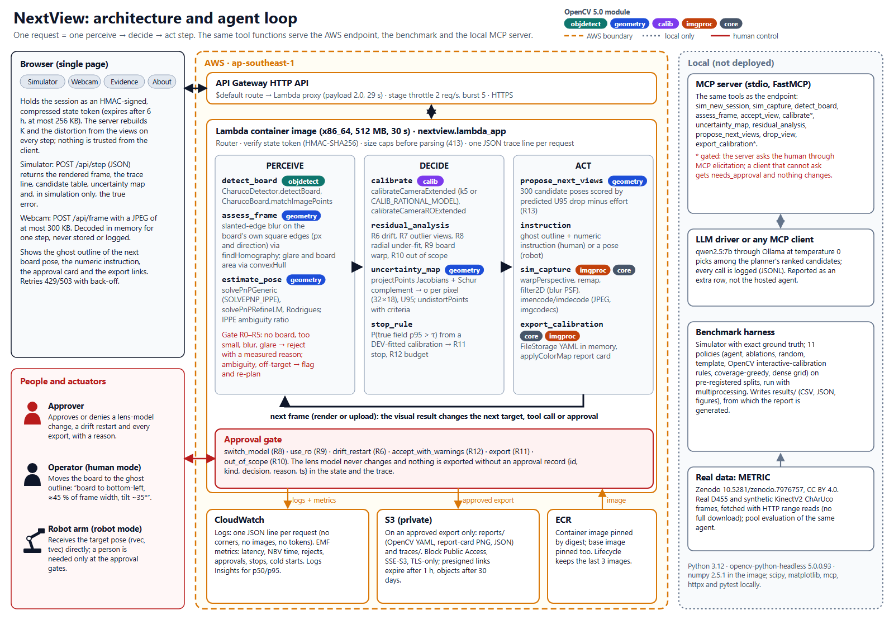

# NextView

**Where should the calibration board go next?** NextView is an agent that calibrates a camera by deciding, frame by frame, where the ChArUco board should be placed. Each step it inspects the new frame with OpenCV 5 tools, rejects bad frames with a measured reason (slanted-edge blur on the board's own edges, glare, a board that is missing or too small), refits the camera, maps the per-pixel uncertainty of the calibration over the whole image, and asks for the pose predicted to shrink that uncertainty most. A person approves every lens-model change and every export. The agent stops when a calibrated probability says the full-image error is below target, and declines lenses it cannot model.

- **Live endpoint:** <https://t4zn85l054.execute-api.ap-southeast-1.amazonaws.com> (AWS Lambda container behind an API Gateway HTTP API, ap-southeast-1)
- **Technical report:** [`docs/report.pdf`](docs/report.pdf) (source [`docs/report.md`](docs/report.md)); architecture: [`docs/architecture.svg`](docs/architecture.svg)
- **Pre-registration:** [`docs/preregistration.md`](docs/preregistration.md); results: [`results/`](results/README.md)
- **Demo video:** <https://youtu.be/0aQBOavDezg> (4:23, synthetic narration, burned-in captions; caption file [`docs/video/nextview-demo.srt`](docs/video/nextview-demo.srt))
- **Team:** Umar Mohktar, Singapore (solo entrant: design, implementation, evaluation). GitHub: [GitHubMoreLikeGitGud](https://github.com/GitHubMoreLikeGitGud)





## Judge walkthrough (about 2 minutes)

The endpoint is throttled to 2 requests/s with at most 5 concurrent executions; when it is busy the page shows "Busy — retrying" and retries on its own.

1. Open the live endpoint. The **Simulator** tab is selected with the preset *Wide-angle robot cam, hand-held* and the *Human* actuator. Press **Start** (the first request may take a few seconds while the container and the simulated camera warm up), then **Auto-run**.
2. Watch the **Agent trace** on the right. Each line is one decision with the measurement behind it: `R2_BLUR` rejects a frame and names the motion direction, `R0_NO_BOARD` moves on to the next-ranked candidate, `R13_NBV` says where the uncertainty is largest and where the board goes next. The dashed **ghost outline** on the frame is the next target, and the **candidate table** shows the predicted gain and effort of the top five poses (click a row to override the choice). Tick *Uncertainty 32×18* to see the per-pixel map.
3. After 12 or more views, the wide lens trips the lens-model check: auto-run pauses on a **switch_model** approval card with the radial-trend p-value, held-out errors of both models and a residual vector field. Press **Switch to rational model** (or **Keep k5 (pin model)**, which pins the model while planning continues).
4. When `R11_STOP` fires (the probability that the true full-image p95 exceeds 0.75 px is below 0.10), the **export** card asks for approval; if the budget runs out first, `R12_BUDGET` asks whether to accept with warnings (**Accept with warnings**). Press **Export calibration** to get the OpenCV YAML, the report-card PNG and the JSON trace (download links expire after an hour).
5. The **race chart** plots the simulator's true error against a random-pose shadow track on the same camera. A single session is not evidence: after an approved model switch it mixes view planning with the better lens model. Policy comparisons are in the pre-registered benchmark (report §8).
6. Optional: the **Webcam** tab runs the same agent on a real camera. On your phone, open <https://t4zn85l054.execute-api.ap-southeast-1.amazonaws.com/api/board.png?kind=screen> (the page's "Show this board on your phone" link), point the computer's camera at it, then *Start camera*, *Start session*, *Capture*. Frames are processed in memory and never stored.
7. The **Evidence** tab shows the benchmark's headline numbers, figures E1–E12 and the failure gallery, baked into the image from [`results/`](results/README.md) at deploy time; the **About** tab lists the data attribution and the limits.

## Results in brief

From the pre-registered synthetic TEST split (6,600 runs: 100 simulated cameras × 3 seeds × robot/human actuators × 11 policies, exact ground truth; numbers from `results/synth_test/summary.json`):

| Pre-registered endpoint (A = agent, B0 = random poses) | Robot | Human |
|---|---|---|
| True full-image p95 error after 10 frames, A vs B0 (median, px) | 1.21 vs 2.71 | 1.22 vs 3.61 |
| Paired median difference [95 % CI], Holm-corrected p | −1.44 [−1.79, −1.05], 3.8 × 10⁻¹⁵ | −1.91 [−2.97, −1.09], 3.8 × 10⁻¹⁵ |
| Frames until true p95 < 1 px, A vs B0 (median; 31 = not reached) | 8 vs 31 | 10 vs 31 |

All eight endpoints (against random poses, a textbook template and an emulation of OpenCV's interactive-calibration app) favour the agent after Holm correction. Results that go against the stated hypotheses are reported too: the perception gate adds no accuracy in simulation and costs a hand-held operator extra attempts; on real METRIC data the agent's frame selection is not consistently better than random; the first-order uncertainty map under-covers and the stop rule never stops on telephoto lenses. See the report for the full evaluation, failure cases and limitations.

## Quickstart (local)

Python 3.12 is required (`requires-python >=3.12,<3.13`). Use a fresh virtual environment: the global `opencv-python` package and the headless one both provide `cv2`.

```powershell
py -3.12 -m venv .venv
.venv\Scripts\pip install -r requirements-dev.txt       # pinned; requirements-dev.lock.txt is the exact Windows environment
.venv\Scripts\pip install -e . --no-deps
.venv\Scripts\python scripts\bake_evidence.py                        # fills the local Evidence tab (git-ignored build output)
.venv\Scripts\python -m nextview.lambda_app.devserver --port 8765    # open http://localhost:8765
```

On Linux or macOS use `python3.12 -m venv .venv` and `.venv/bin/...`. The dev server wraps the same Lambda handler (each HTTP request becomes an API Gateway v2 event); without `NEXTVIEW_STATE_KEY` it uses a random per-process key and keeps exports in memory.

**Run the agent without the web UI:**

```powershell
.venv\Scripts\python scripts\agent_presets.py --out results\tmp\presets.json      # all six presets, end to end
.venv\Scripts\python -m nextview.mcp_server.server                                   # MCP server over stdio
.venv\Scripts\python -m nextview.mcp_server.llm_driver --model qwen2.5:7b --approval ask   # needs a local Ollama
```

The MCP server exposes the same tools as the endpoint (`sim_new_session`, `sim_capture`, `detect_board`, `assess_frame`, `accept_view`, `calibrate`, `uncertainty_map`, `residual_analysis`, `propose_next_views`, `drop_view`, `export_calibration`, plus `image_new_session` and `observe_image` for image files). Model changes and exports ask the human through MCP elicitation; a client that cannot elicit gets `needs_approval`.

## Tests

```powershell
.venv\Scripts\python -m pytest            # default: -m "not slow and not live"
.venv\Scripts\python -m pytest -m slow    # slow tests (blur curve and similar)
pwsh infra/smoke_test.ps1 -Url https://t4zn85l054.execute-api.ap-southeast-1.amazonaws.com   # live endpoint
```

The default suite gives 362 passed, 6 skipped (need `data_ext/` from `scripts/fetch_metric.py` and the OpenCV samples), 2 deselected; 368 with the data (about 2.5 minutes, single process). The tests cover the renderer's corner bias, the ESF blur estimate, pose and IPPE ambiguity, the Schur-complement covariance against brute force and Monte Carlo, the NBV planner, every policy rule and approval gate, the signed state token, the Lambda handler (caps, CSP, logs without image data), the benchmark statistics and the MCP server.

## Reproduce the benchmark

Every number in the report is read from `results/` by [`docs/tools/build_report.py`](docs/tools/build_report.py); see [`results/README.md`](results/README.md) for which command produced each file. Runs are deterministic (single-threaded OpenCV and BLAS).

```powershell
$py = ".venv\Scripts\python"
& $py -m nextview.bench.run_synthetic --split dev --out results/synth_dev                 # DEV: cameras 0-39, A and B0
& $py -m nextview.bench.fit_stop --runs results/synth_dev/runs.csv --out config/stop_calibration.json
& $py -m nextview.bench.run_synthetic --split test --out results/synth_test               # TEST: 6,600 runs
& $py -m nextview.bench.summarize --runs results/synth_test                               # pre-registered endpoints
& $py -m nextview.bench.consequence --runs results/synth_test                             # mm table
& $py -m nextview.bench.run_synthetic --split failure --out results/synth_failure         # abstention set
& $py -m nextview.bench.gallery --out results
& $py -m nextview.bench.plots                                                             # results/figures
& $py scripts\fetch_metric.py                                                             # METRIC subsets via HTTP range reads
& $py -m nextview.bench.run_pool --out results/pool                                       # real-data pool protocol
& $py -m nextview.bench.llm_row --models qwen2.5:7b --out results/llm_row                 # LLM row; needs Ollama
```

The TEST run took 64 minutes on 14 worker processes (`results/synth_test/meta.json`); `--workers` sets the count. The full TEST `runs.csv` (46 MB) is not committed; `runs_core.csv.gz` holds every row and metric (rounded to 3–4 significant digits) and the runner regenerates the full file exactly. The frozen thresholds, stop calibration and source-tree hashes are listed in `docs/preregistration.md`.

**Check the pre-registration and the endpoints without re-running the benchmark** (seconds, committed files only):

```powershell
New-Item -ItemType Directory -Force results/tmp | Out-Null      # git-ignored output folder for the two checks below
& $py scripts\verify_prereg.py                                  # recompute the frozen hashes from results/prereg/, list what changed since
& $py -m nextview.bench.summarize --runs results/synth_test --out results/tmp/summary_check.json   # PE1-PE8 from runs_core.csv.gz
& $py -m nextview.bench.consequence --runs results/synth_test --inversion-only --out results/tmp/inversion_check.json
```

Values from the compact table can differ from `summary.json` in their last digits (rounding); the endpoint decisions are the same.

**Documentation build** (optional; uses `markdown` 3.10.2 and `playwright` 1.62.0 with its Chromium):

```powershell
pip install markdown==3.10.2 playwright==1.62.0; python -m playwright install chromium
python docs\tools\draw_architecture.py      # docs/architecture.svg + .png
python docs\tools\build_report.py           # docs/report.md (from docs/tools/report.template.md) + docs/report.pdf
```

## Deploy and tear down (AWS)

Requirements: AWS CLI v2, Docker with `buildx`, PowerShell 7, and credentials for an IAM principal allowed to use ECR, Lambda, API Gateway v2, S3, CloudWatch Logs, IAM (one role) and STS. Credentials come from the environment, for example:

```powershell
$env:AWS_PROFILE = "<your profile>"; $env:AWS_REGION = "ap-southeast-1"
pwsh infra/deploy.ps1                      # idempotent: role, ECR (scan on push), Evidence bake, image build/push, logs, S3, Lambda, HTTP API, smoke test
pwsh infra/smoke_test.ps1                  # health, page, CSP, presets, board, evidence, session and 3 steps
.venv\Scripts\python infra\load_test.py --sessions 3 --steps 15 --concurrency 3
pwsh infra/teardown.ps1 -DryRun            # list what would be removed
pwsh infra/teardown.ps1                    # remove everything (refuses 27 Oct to 9 Nov 2026 without -AllowDuringJudging)
```

`deploy.ps1` creates nothing that already exists, keeps the API URL and the `NEXTVIEW_STATE_KEY` across runs, bakes the Evidence tab with `scripts/bake_evidence.py` (figures from `results/figures/` and the report's headline numbers; build output, git-ignored), builds `linux/amd64` with `--provenance=false`, updates the function by image digest, and writes [`infra/deployed.json`](infra/deployed.json) (URL, tag, digests, memory; no secrets). Parameters include `-MemoryMb` (default 2048; it steps down to the account's cap, 512 MB on the deployment account), `-ThrottleRate 2`, `-ThrottleBurst 5`, `-LogRetentionDays 14`. No CloudFormation, CDK, SAM or Function URL is used.

**Kill switch.** `aws lambda put-function-concurrency --function-name opencv-hackathon-nextview --reserved-concurrent-executions 0` makes every request return 503; `aws lambda delete-function-concurrency --function-name opencv-hackathon-nextview` restores service.

**Cost guard.** [`infra/guard.py`](infra/guard.py) reads the last 24 h of CloudWatch usage and, with `--apply`, warns, lowers the stage throttle, or engages the kill switch at the daily ceiling (`--restore` undoes it; without `--apply` it is a dry run). `--insights results/ops_insights.json` writes the Logs Insights numbers used in the report. To run it hourly through the judging period (Windows, one line; replace the placeholders):

```powershell
schtasks /Create /F /TN "NextView guard" /SC HOURLY /MO 1 /SD 26/10/2026 /ST 00:05 /ED 10/11/2026 /TR "<repo>\.venv\Scripts\pythonw.exe <repo>\infra\guard.py --apply --profile <profile> --aws-dir <dir>"
```

## Pinned versions

| Component | Version |
|---|---|
| Python | 3.12 (local 3.12.0; Lambda image 3.12.15) |
| opencv-python-headless | 5.0.0.93 (`cv2.__version__` 5.0.0) |
| numpy | 2.5.1 |
| Dev only | scipy 1.18.0, matplotlib 3.11.2, pytest 9.1.1, mcp 1.28.1, httpx 0.28.1 (`requirements-dev.txt`; full freeze in `requirements-dev.lock.txt`) |
| boto3 (from the base image) | 1.42.97 |
| Deployed image | tag `389fb6f` (pre-publication build id; the image was built from this commit's `src/` and `config/` trees: `git rev-parse HEAD:src` = `a04d9ed99075164c8ef4b8193ee928cc2b635840`, `git rev-parse HEAD:config` = `6f2d1a5b0dccc2309fe0b4de925f01e424b7fac0`), digest `sha256:33f6881335256fb32b89eddf909e2ac0b254dc10f0160d3b9c082867ed14dd04` (`infra/deployed.json`) |
| Base image | `public.ecr.aws/lambda/python:3.12@sha256:25aee9bac65f131c5d090d3e3a36ccf232d65cf3e6c1dbd0bffd43ca7ce34406` (manifest list; linux/amd64 manifest `sha256:c73d459e2dcaefa83c47c095560ad164d732251312b3371c7a49c46f1c4d4ff5`) |
| Local LLM row (not deployed) | Ollama 0.40.7, qwen2.5:7b, nemotron-3-nano:4b |

The image installs only `requirements-lambda.txt` (OpenCV headless and numpy); `infra/deployed.json` always holds the digest of the running image.

## Repository layout

```text
src/nextview/tools/        OpenCV 5 tools: detect, ESF blur, quality, pose, calibrate, uncertainty, residuals, NBV, export
src/nextview/agent/        state token, policy rules R0-R13, approvals, instructions, run_step loop
src/nextview/sim/          lens families, renderer, nuisances, actuators, ground truth
src/nextview/bench/        policies and baselines, synthetic and pool runners, statistics, plots
src/nextview/lambda_app/   handler, routes, S3, logs/metrics, dev server, web UI
src/nextview/mcp_server/   MCP server and LLM driver
config/                    thresholds (frozen), stop calibration, presets
infra/                     deploy, smoke test, load test, teardown (PowerShell), cost guard, IAM and bucket policies
scripts/                   METRIC fetch, end-to-end preset runs, Evidence bake, ECR scan summary, pre-registration check
results/                   benchmark outputs (CC BY 4.0)
docs/                      report, architecture, pre-registration
```

## Data and licences

- Code: MIT ([`LICENSE`](LICENSE)). Benchmark outputs in `results/`: CC BY 4.0.
- Real data: **METRIC** (Davide Allegro, Matteo Terreran, Stefano Ghidoni, 2023, Zenodo, [doi:10.5281/zenodo.7976757](https://doi.org/10.5281/zenodo.7976757)), CC BY 4.0. Fetched by `scripts/fetch_metric.py` into `data_ext/` (git-ignored); not redistributed.
- Full attribution, including third-party software: [`ATTRIBUTION.md`](ATTRIBUTION.md).

## Limitations

- The primary results are graded on our own simulator; the wide lens family was designed so that a k5 model cannot fit it. Real-data results (METRIC) are descriptive and do not show an advantage.
- The uncertainty map is first order and under-covers; the stop probability is calibrated in simulation and transferred to webcam and real sessions.
- On a wide lens, a k5 fit cannot be inverted near the image corners before the lens-model switch, so length measurements there can be off by tens of millimetres (report §8.4).
- The human actuator is a simulation of a person; the webcam path has been exercised with a synthetic camera stream, not yet with a physical camera on the live site.
- Pinhole (k5) and rational lens models only; fisheye lenses are declined; rolling shutter is not modelled.
- The drift rule (R6) at its frozen threshold misses some drift and raises false alarms; the telephoto family never reaches the stop rule.
- The Lambda function runs at 512 MB (account cap), about 1.4 s per step at p50 server-side.

## Responsible use

- Decision support, not certified metrology.
- No lens-model change and no export without a recorded human approval; budget exhaustion escalates to a person; out-of-scope lenses are declined.
- Webcam frames are decoded in memory for one step and never stored or logged; logs contain no corners, images or tokens. Faces are not masked, so show only the board.
- Sessions expire after 6 hours; exports after 30 days, their links after 1 hour. The API is throttled and has a kill switch.
- The trace is the audit record of every decision.
