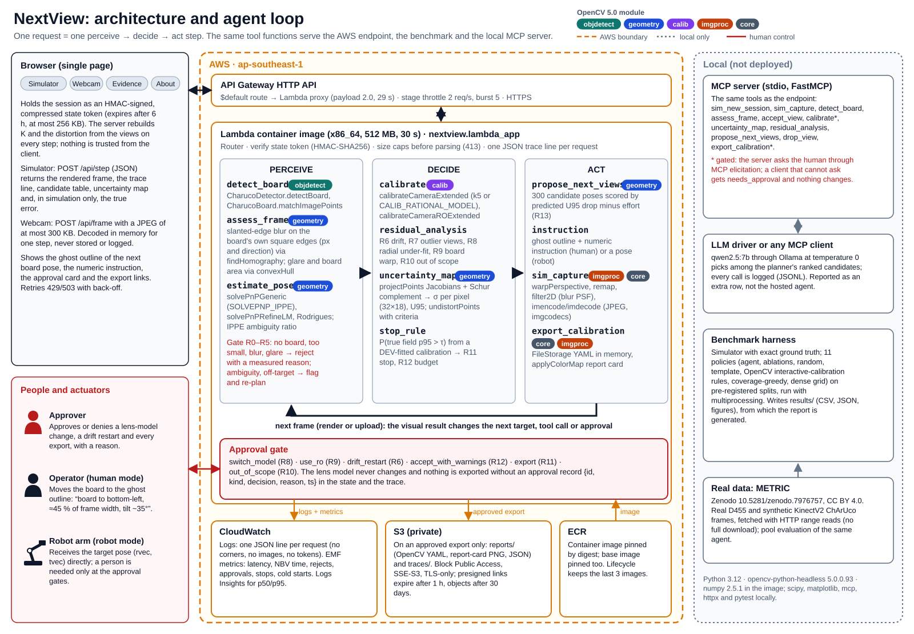
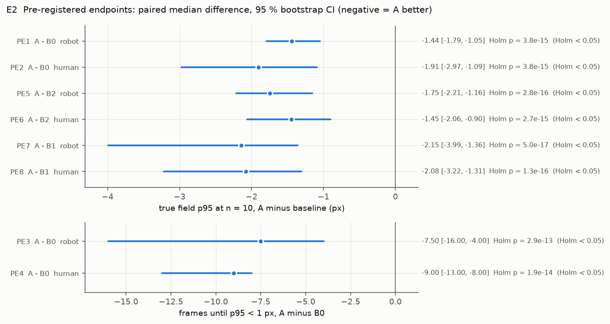
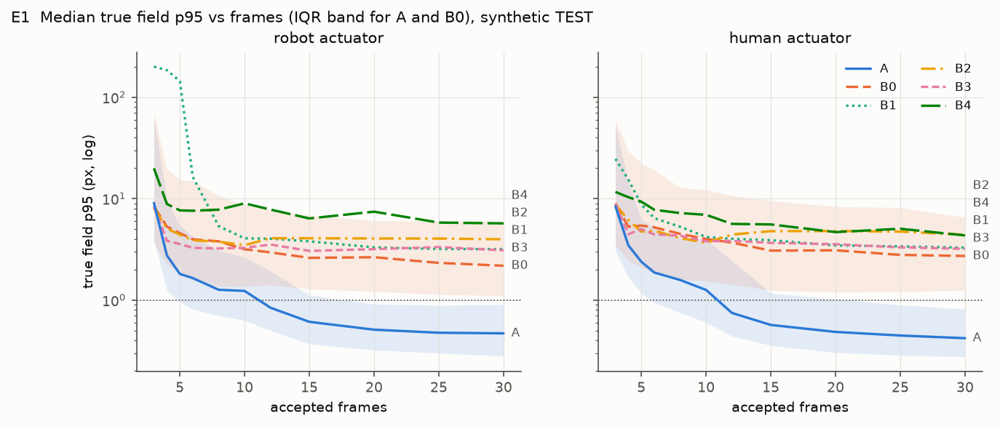
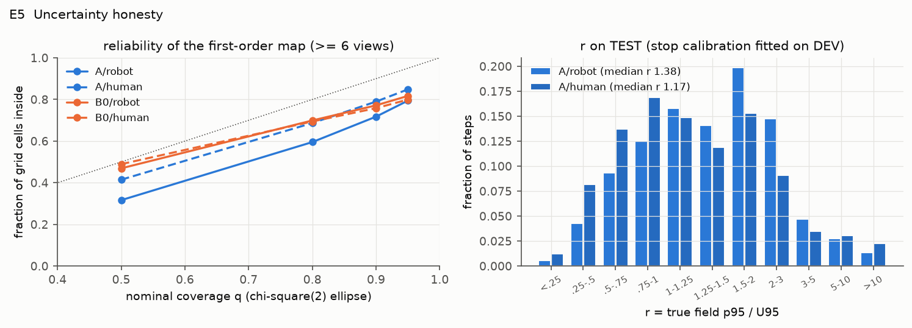
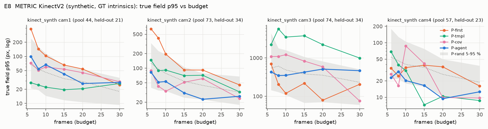
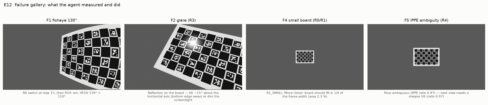

<!-- Generated by docs/tools/build_report.py from docs/tools/report.template.md and the results files; edit the template, not this file. -->
# NextView: an agent that decides where the calibration board goes next

Technical report · OpenCV AI Competition 2026 (powered by AWS) · Umar Mohktar, Singapore (solo entrant: design, implementation, evaluation) · Code: [github.com/GitHubMoreLikeGitGud/nextview](https://github.com/GitHubMoreLikeGitGud/nextview) · Live endpoint: [https://t4zn85l054.execute-api.ap-southeast-1.amazonaws.com](https://t4zn85l054.execute-api.ap-southeast-1.amazonaws.com) · Image `389fb6f` (pre-publication build id; the image was built from this commit's `src/` and `config/` trees, `git rev-parse HEAD:src` = `a04d9ed99075…`, `HEAD:config` = `6f2d1a5b0dcc…`)

## 1. Summary

NextView calibrates a camera by deciding, frame by frame, where the ChArUco board should go next. Every step it inspects the new frame with OpenCV 5 tools, rejects a bad frame with a measured reason (blur measured on the board's own edges, glare, a board that is missing or too small), refits the camera, maps the per-pixel uncertainty of the calibration over the whole image, and asks for the board pose predicted to shrink that uncertainty most. A person approves every lens-model change and every export. It stops when a calibrated probability says the true full-image error is below target, and it abstains when the lens is out of scope. It runs as a stateless AWS Lambda container behind an API Gateway HTTP API, and the same tools are exposed to any agent over MCP.

Three headline numbers, from the pre-registered synthetic TEST split (6,600 runs: 100 simulated cameras × 3 seeds × 2 actuators × 11 policies, exact ground truth, `results/synth_test/summary.json`):

1. **Accuracy at a fixed budget.** After 10 accepted frames the median true full-image p95 error is **1.21 px** for the agent against **2.71 px** for random board poses with a robot actuator, and **1.22 vs 3.61 px** with a simulated hand-held board. All eight pre-registered endpoints favour the agent after Holm correction (largest corrected p = 2.9 × 10⁻¹³).
2. **Frames needed.** The median number of accepted frames until the true p95 is first below 1 px is **8 vs 31** (robot; 31 means "not reached in 30") and **10 vs 31** (human).
3. **Stopping.** The calibrated stop rule stopped 319 of 600 agent runs with **0 false stops** (true p95 above 2τ = 1.5 px). It never stopped on telephoto lenses, and its first-order uncertainty map under-covers: its 95 % error ellipses hold 0.79 of the true errors (robot; §8.5).

Several results go against the stated hypotheses: the perception gate adds no accuracy in simulation and costs a hand-held operator extra attempts; on real METRIC data the agent's frame selection is not consistently better than random selection; the median predicted gain of a view is 2.0× (robot) to 2.6× (human) the realised gain. All primary results are simulator-graded.

## 2. Problem and users

Every metric vision system inherits its calibration error: measurement and inspection, AR overlays, SLAM, multi-camera digital twins. The common practice is to wave a board, capture 20 to 50 frames and judge the result by the in-sample RMS reprojection error. That number says little about the parts of the image the board never reached. In my simulated benchmark (robot, run-level medians) the agent's own in-sample RMS after 10 frames had a median of **0.066 px**, while the true p95 error over the whole image was **1.23 px**, about 19 times larger. People also keep blurred or ambiguous frames, rarely notice an under-fitted distortion model, and do not know when to stop. Calibration is step 0 of every metric inspection.

**Users.** (1) *Human mode*: a technician, student or maker calibrating a robot, drone, inspection or measurement camera. The agent coaches them with a ghost outline of the next board pose and a numeric instruction ("board to bottom-left, ≈ 45 % of frame width, tilt ~35°, left edge away"), which they execute imprecisely. (2) *Robot mode*: commissioning an inspection cell where the board or camera is on an arm; the agent commands poses directly. (3) *Approver*: the engineer who signs off a lens-model change and the exported calibration. The presets (Appendix C) cover an inspection-robot gauge camera, a drone survey camera, a phone used for crack metrology and a hand-held wide-angle robot camera.

## 3. Prior art and contribution

Guided calibration is not new: Rojtberg & Kuijper (ISMAR 2018, *pose_calib*) select poses from a fixed set; Peng & Sturm (ICCV 2019, *Calibration Wizard*) propose the next pose from an uncertainty model; mrcal (NASA JPL) popularised projection-uncertainty maps; OpenCV's `interactive-calibration` app accepts frames and stops by its own rules (emulated here as baseline B2). No code from these projects is used. **Not claimed:** a new next-best-view theory. **Claimed:** an open OpenCV 5 toolset and agent loop with explicit, logged, state-driven re-planning; human approval gates for model changes and exports; a calibrated stop/abstain decision; a public serverless endpoint; an MCP interface; and a pre-registered, reproducible benchmark with exact ground truth, real third-party data and published null results.

## 4. Architecture

<p align="center"></p>

*Figure 1. Architecture (`docs/architecture.svg`). Left: browser client and the people in the loop. Centre: AWS (API Gateway HTTP API, Lambda container from ECR, S3, CloudWatch). Right: local MCP server, LLM driver, benchmark harness and real data. Colours mark the OpenCV 5 module behind each tool.*

**One step.** (1) The browser posts the signed state token (plus a JPEG in webcam mode). (2) The handler checks the size caps, verifies the HMAC and expiry, and rebuilds the session; K and the distortion are never trusted from the client but refitted from the stored views. (3) *Perceive*: the frame is rendered by the simulator at the requested pose (or decoded from the upload), then `detect_board`, `assess_frame` and `estimate_pose` measure it, and the gate (R0–R5) accepts or rejects it with a reason. (4) *Decide*: `calibrate`, `residual_analysis` (R6–R10) and `uncertainty_map` update the model; the stop rule computes P(true field p95 > τ). (5) *Act*: `propose_next_views` ranks candidate poses; the response carries the ghost outline, the instruction, the candidate table, the trace line and, if a rule needs a person, an approval card. (6) One JSON log line with embedded CloudWatch metrics is written; no corners, images or tokens are logged.

## 5. Agent

**State.** Accepted views (corner ids, corners rounded to 0.01 px, quality, pose, prequential error), rejected attempts (rule and value only), the lens model and whether it is pinned, budget and attempt counters, the last target, the open approval card and the approval history, flags (`UNDERFIT`, `WARP`, `DRIFT`, `AMBIGUOUS`, `OUT_OF_SCOPE`) and a per-step history. It travels as `v1.<zlib JSON>.<HMAC-SHA256>`, at most 256 KB, expiring after 6 h.

**Tools** are pure functions in `nextview.tools` (Figure 1, §6), shared by the Lambda routes, the benchmark and the MCP server.

**Policy.** Deterministic and priority-ordered; exactly one primary rule fires per step and writes a trace line `#<step> <RULE>: <measurement> → <action>`.

| Rule | Trigger (frozen thresholds, Appendix A) | Action |
|---|---|---|
| R0 NO_BOARD | < 12 ChArUco corners, or corners spanning < 2 rows or columns | reject; try the next-ranked candidate |
| R1 SMALL | board area < 4 % of the frame | reject: "move closer" |
| R2 BLUR | slanted-edge 10–90 % rise > 3.0 px | reject; with anisotropy ≥ 1.5 the instruction names the motion direction |
| R3 GLARE | > 2 % saturated pixels inside the board hull | reject; tilt about the axis perpendicular to the hotspot offset |
| R4 AMBIGUOUS | IPPE error ratio > 0.85 | accept, flag; next target must tilt ≥ 25° |
| R5 OFF_TARGET | human mode, realised pose > 15° or > 20 % of width off target | accept ("data is data"), re-plan |
| R6 DRIFT | last 3 views each have prequential RMS > 3 × the session median | pause; **approval**: lock focus and restart, or continue |
| R7 OUTLIER | per-view RMS > median + 3·1.4826·MAD and > 0.5 px | drop the view, refit (logged, reversible) |
| R8 UNDERFIT | ≥ 12 views, radial-trend p < 0.01, 3-fold held-out RMS of the rational model < 0.90 × k5 | **approval** to switch to `CALIB_RATIONAL_MODEL`; deny pins k5 |
| R9 WARP | ≥ 6 full-board views, warp score ≥ 0.30, held-out gain of RO ≥ 10 % | **approval** to use `calibrateCameraROExtended` |
| R10 OUT_OF_SCOPE | rational model and estimated horizontal FOV > 110° † | escalate: "use `cv2.fisheye`"; session ends |
| R11 STOP | ≥ 6 views, P_exceed < 0.10, last 2 prequential RMS ≤ 1.5 × in-sample, no open flag | stop; **approval** to export |
| R12 BUDGET | 30 views or 60 attempts | **approval**: accept with warnings (P_exceed shown) or discard |
| R13 NBV | otherwise | propose the next views; the top candidate becomes the target |

*† As built, R10 does not also require radial p < 0.01 after the switch: on the fisheye lens the rational fit leaves no significant radial trend, so that condition made R10 unreachable. The radial-trend p-value treats every corner residual as independent, but the corners of one view share a pose error, so it is a screening statistic rather than a calibrated probability (values such as 10⁻²⁹ only say the trend is consistent); R8 also requires the view-level 3-fold held-out test, and the UI labels the value a corner-level screen. R9 runs its cross-validation one fold per step on the last 12 full-board views, plans full-board poses while a warp is suspected, and holds R7 back meanwhile, to stay inside the Lambda step budget. R6 keeps the spec's factor 3.0 (see §9).*

**How visual results change the next action** (the Agentic Vision criterion), with how often each fired in the 600 agent runs on TEST (trace lines in `results/synth_test/events.jsonl.gz`):

| Visual result | What changes | Fired on TEST |
|---|---|---|
| Board missing or too few corners | Frame rejected; the next-ranked candidate is tried | R0: 1,454 times in 336 runs |
| ESF blur and its direction | Frame rejected; the wording of the next instruction | R2: 5,762 in 301 runs |
| Glare hotspot location | Frame rejected; the tilt axis in the instruction | R3: 664 in 147 runs |
| IPPE ambiguity | A constraint on the next target (tilt ≥ 25°) | R4: 49 in 41 runs |
| Realised pose off target (human) | Re-plan from where the board actually went | R5: 1,290 in 291 runs |
| Uncertainty map / coverage hole | Which pose is requested next | R13: 16,334 uncertainty-planned next views (plus 1,220 seeded opening poses) in 600 runs |
| Radial residual trend | The next tool call (`calibrate(model="rational")`), behind approval | R8: 149 cards in 149 runs |
| Per-view residual outlier | A `drop_view` call and a refit | R7: 911 drops in 478 runs |
| Prequential error spike | Drift approval request | R6: 10 in 10 runs, all false alarms (TEST has no drift) |
| P(true p95 > τ) | Stop, continue or escalate to a human | R11: 319 stops; R12: 199 escalations |

<p align="center"></p>

*Figure 2. The live app (an earlier build) at step 20 of the wide-lens preset, hand-held, seed 42: the frame with detected corners and the R8 approval card (radial-trend p-value, held-out RMS of both models, residual vector field, reason box). The camera is simulated.*

**A real trace.** Excerpt, verbatim, from the TEST log (`results/synth_test/events.jsonl.gz`, session `test|1025|wide|0|human|A`: wide lens, hand-held). In the benchmark, approvals are automatic: model changes are approved, and the export after the first stop is denied so that every run continues to 30 frames.

```text
#2 R2_BLUR: edge rise 6.87 px > 3.0 px, anisotropy 2.99, blur along 15° → reject
   …
#5 R13_NBV: largest σ top-right 23.25 px, U95 2.77 px, P(>τ)=0.99 → target top-right, tilt 20° az 225° (predicted ΔU95 1.958 px)
   …
#9 R5_OFF_TARGET: realised pose 16° and 4% of the width from target → accept, re-plan from the new view
   …
#11 R7_OUTLIER: view(s) [7] per-view RMS above median 0.13 px + 3·1.4826·MAD and > 0.5 px → drop view(s), refit
   …
#12 R0_NO_BOARD: 0 corners over 0×0 rows×cols (need 12, ≥2×2) → reject, next candidate (rank 2): top-left, tilt 35° az 180°
   …
#21 R8_UNDERFIT: radial-trend p 1.4e-27 < 0.01, held-out RMS k5 0.177 vs rational 0.105 px (41% better) → propose CALIB_RATIONAL_MODEL
#22 APPROVAL ap_1 switch_model: approve (bench) → refit with CALIB_RATIONAL_MODEL
#22 R13_NBV: largest σ bottom-left 63.82 px, U95 0.73 px, P(>τ)=0.69 → target top-left, tilt 50° az 45° (predicted ΔU95 0.344 px)
   …
#45 R11_STOP: P(field p95 > 0.75 px) = 0.09 < 0.1, U95 0.27 px, prequential 0.11, 0.05 ≤ 1.5× RMS 0.10 px → stop, ask to export
#46 APPROVAL ap_2 export: deny (bench) → session stays open, continue
```

`R13_NBV` first names the cell with the largest σ, then the chosen target, and the two often differ. The target is the candidate with the best score (predicted U95 drop, minus an effort penalty in human mode). A view constrains the intrinsics, which move σ over the whole image, so a pose elsewhere can lower U95 more, and poses that would cover an extreme corner are often infeasible (at least half of the corners must stay 5 px inside the frame).

**Uncertainty and next-best view.** With θ = (fx, fy, cx, cy, d₁…dₙ), p = 4 + n, each view's `projectPoints` Jacobian is split into pose columns J_φ (2N_v × 6) and intrinsic columns J_θ. The pose is eliminated per view with a Schur complement, S_v = J_θᵀJ_θ − J_θᵀJ_φ (J_φᵀJ_φ)⁻¹ J_φᵀJ_θ, and F = Σ_v S_v is exactly the Gauss-Newton marginal information of θ, because each pose appears in its own view only. With σ̂² = rms² · N / (2N − p − 6V), Σ_θ = σ̂² F⁻¹. (`calibrateCameraExtended` returns only diagonal standard deviations; a unit test checks ours against them within 15 %.) For each cell of a 32 × 18 grid, the ray is found with `undistortPoints` (with termination criteria; `undistortPointsIter` does not exist in OpenCV 5.0), G is the intrinsic Jacobian of `projectPoints` at that ray, and σ_ij = √trace(G Σ_θ Gᵀ), the RMS (1σ) radius of the predicted reprojection error at that cell. U95 is the 95th percentile of σ over the grid: a scale summary of the map, not a 95 % bound on the error. A candidate's gain is U95(σ̂² F⁻¹) − U95(σ̂² (F + S_c)⁻¹), with S_c computed over the corners predicted visible. Candidates come from a 1,125-point lattice (5 × 3 image cells × 3 sizes × 25 orientations) of which 300 are sampled and checked for feasibility (≥ 50 % of corners inside a 5 px margin, tilt < 60°, area ≥ 4 %); score = gain − λ · effort · max gain, with λ = 0.3 in human mode (prefer nearby poses) and 0 in robot mode. This is first order and assumes the lens model is right.

**Stop calibration.** On the DEV split only, r = true p95 / U95 was collected at every agent step with ≥ 6 views (982 robot and 929 human steps); its median was 1.35 (robot) and 1.30 (human). Because U95 summarises 1σ radii, r would exceed 1 even for an exact first-order map, so r alone does not measure optimism; the χ²(2) coverage in §8.5 does. The calibration only has to map U95 to the chance that the true p95 exceeds τ. The stop probability is P_exceed = 1 − F̂_r(τ / U95) from 101 stored quantiles. τ was frozen at 0.75 px by the pre-declared rule (§8.1). Webcam and real sessions reuse this calibration, labelled "transferred from simulation" in the UI.

**Approval gates.** `switch_model` (R8), `use_ro` (R9), `drift_restart` (R6), `accept_with_warnings` (R12), `export` (R11 or after R12) and `out_of_scope` (R10). Each card shows its evidence (for R8: the radial-trend p-value, held-out RMS of both models and a 16 × 9 residual vector field). A model change or an export happens only inside `apply_approval`, which writes `{id, kind, decision, reason, ts}` into the state and the trace; denying a model switch pins the model and planning continues.

**MCP interface.** `nextview.mcp_server` is a FastMCP stdio server exposing the same tools one at a time (`sim_new_session`, `sim_capture`, `detect_board`, `assess_frame`, `accept_view`, `calibrate`, `uncertainty_map`, `residual_analysis`, `propose_next_views`, `drop_view`, `export_calibration`, plus `image_new_session`/`observe_image` for real image files). Model changes and exports ask the human through MCP elicitation; a client that cannot elicit gets `needs_approval` and nothing changes, so a model cannot approve its own request. Ground-truth tools exist only behind an `--evaluator` flag used by the benchmark harness. Results of a local LLM driving these tools are in §8.7.

## 6. OpenCV 5 implementation

All vision work uses `opencv-python-headless` 5.0.0.93 (`cv2.__version__` 5.0.0) and numpy 2.5.1; there is no DNN in the core loop and no training.

| Module (5.0.0) | APIs used | Where |
|---|---|---|
| objdetect | `aruco.CharucoBoard` (`generateImage`, `getChessboardCorners`, `matchImagePoints`), `aruco.CharucoDetector.detectBoard`, `aruco.ArucoDetector`; `findChessboardCornersSB`, `estimateChessboardSharpness` (fallback chessboard loader) | detection, board images, METRIC board probe |
| geometry | 3d: `solvePnPGeneric` (`SOLVEPNP_IPPE`), `solvePnPRefineLM`, `Rodrigues`, `projectPoints` with Jacobians, `undistortPoints` with criteria, `findHomography`; 2d: `convexHull`, `contourArea`, `intersectConvexConvex` | pose, uncertainty, NBV, ESF edge geometry, board hull, truth |
| calib | `calibrateCameraExtended` (k5; `CALIB_RATIONAL_MODEL`), `calibrateCameraROExtended` (release-object fit for warped boards) | calibration, R8/R9 cross-validation |
| imgproc | `warpPerspective`, `remap`, `filter2D` (motion and defocus PSF), `GaussianBlur`, `fillConvexPoly`, `resize`, `cvtColor`, `applyColorMap`, `putText` | simulator, masks, report card |
| core, imgcodecs | `FileStorage` in memory mode with `releaseAndGetString`, `perspectiveTransform`, `imencode`/`imdecode`, `setNumThreads(1)` | YAML export without disk, JPEG round-trip, determinism |

Module names follow the 5.0.0 headers: pose and projection functions moved from `calib3d` to the new `geometry` module, and chessboard detection to `objdetect`.

**Slanted-edge blur (ESF).** A local homography fitted to the detected corners gives the scale across each inner edge (black square next to white square). Pixels near the central 60 % of the edge (0.12 square widths on the white side, 0.4 on the uniform black side) are binned at 0.25 px by signed distance; because the edges are slanted against the pixel grid, this builds a super-resolved edge-spread function without interpolation. A Gaussian edge model, which also accounts for the marker border on the white side, gives σ and the 10–90 % rise 2.563σ. Edges are binned by normal direction (0/45/90/135°): the rise in the worst direction is the blur, max/min is the anisotropy, and the direction feeds R2's instruction. At least 8 edges of 8 px or more are required.

**Simulator.** A homography renderer of the board texture with a distortion `remap` on a virtual canvas that covers every pixel's ray (needed for wide lenses), using the +0.5 px texture convention; a unit test bounds the mean corner bias below 0.05 px. Nuisances: motion and defocus PSFs, per-family noise and JPEG, occluders (p = 0.15), post-detection corner corruption (p = 0.05, logged for outlier recall), a mirror-reflection glare hotspot on glossy presets, autofocus drift and a sagged board. Lens families at 1280 × 720: `normal` (HFOV 55–65°, k5), `wide` (95–110°, a rational lens whose k1/k4 pair a k5 polynomial cannot follow, so model selection matters), `tele` (20–28°, principal point hard to pin down), `webcam` (65–75°, heavy noise, JPEG 70, near-focus blur), and `fisheye130` for the failure set. Robot actuator: 1° and 5 mm pose noise. Human actuator: 6° and 3 cm (scaled with distance), with motion blur on half of the frames.

**Honest notes.** `calibrateCameraExtended` reports diagonal standard deviations only, so the full covariance comes from Jacobians. With `CALIB_USE_INTRINSIC_GUESS`, `calibrateCameraROExtended` fails an internal assertion in 5.0.0, so every RO fit starts from OpenCV's own initialisation. `calibrateMultiview` (a planned multi-camera rig twin) and the YuNet face detector were not shipped.

## 7. AWS deployment

| Resource | Configuration |
|---|---|
| API Gateway HTTP API | one `$default` route → Lambda proxy (payload 2.0, 29 s); stage throttle 2 req/s, burst 5 |
| Lambda | container image, x86_64, **512 MB** (the account's cap; 2048 MB was rejected), 30 s timeout; env: bucket name, state key (generated once, kept on redeploy), `OPENBLAS_NUM_THREADS=1`, version |
| ECR | image `sha256:33f6881335256fb32b89eddf909e2ac0b254dc10f0160d3b9c082867ed14dd04`; base `public.ecr.aws/lambda/python:3.12@sha256:25aee9bac65f131c5d090d3e3a36ccf232d65cf3e6c1dbd0bffd43ca7ce34406`; lifecycle keeps 3 images; basic vulnerability scan on push: 0 critical, 12 high, 20 medium and 5 low findings, all in the base image's Amazon Linux packages (curl, krb5, libcurl, libxml2, openssl, pcre2, rpm), none in the packages the image adds (`results/ops/ecr_scan.json`) |
| S3 | private bucket: Block Public Access, SSE-S3, TLS-only policy; `reports/` and `traces/` written only on an approved export, expire after 30 days; presigned GET links for 1 h |
| CloudWatch | log group with 14-day retention; one JSON line per request; EMF metrics (latency, NBV time, rejects, approvals, stops, cold starts), emitted only on HTTP 200 |
| IAM | one execution role: put log events on its own log group, get/put on the three S3 prefixes only |

**Stateless by design.** The whole session lives in the signed token; Lambda keeps nothing between requests except warm caches (a warm-up at init and the simulator's distortion maps, built at session start). Caps: request body 512 KB, webcam JPEG 300 KB and ≤ 1280 × 720 (checked from the header before decoding), token 256 KB, response < 1 MB. Errors return a JSON code; stack traces go only to the logs. Responses carry a strict CSP, `nosniff`, `no-referrer` and `no-store` on `/api/*`.

**Throttling, concurrency, kill switch.** The account allows 5 concurrent executions, so reserved concurrency cannot be set; the stage throttle is the first limit and over-capacity requests get 429 (throttle) or 503 (concurrency). The UI retries both with back-off (0.5, 1, 2, 4 s) and then waits 5 s before trying again. Setting reserved concurrency to 0 is the kill switch: it was tested during deployment (every request returns 503) and removed. `infra/guard.py` can run hourly as a Windows scheduled task (the README has the one-line registration; at the time of writing it was run by hand) and reads the last 24 h of CloudWatch usage: above 15k GB-s it warns, above 40k it lowers the stage throttle, and above 100k (about US$1.67 per day) it engages the kill switch and leaves a marker file; `--restore` undoes both.

**Operations (measured).** Server-side times from CloudWatch Logs Insights (2026-10-22 23:13 to 2026-10-23 05:22 UTC, all traffic since the log group was created; `results/ops_insights.json`):

| Server-side handler time | n | p50 ms | p95 ms | max ms |
| --- | ---: | ---: | ---: | ---: |
| /api/step (sim) | 686 | 1,377 | 2,856 | 7,788 |
| /api/frame (webcam) | 68 | 1,234 | 3,243 | 3,971 |
| /api/approve (sim, incl. S3 + presign) | 21 | 1,232 | 2,028 | 2,049 |
| /api/session (sim, builds the camera maps) | 59 | 1,362 | 3,376 | 3,507 |
| NBV planner inside a step | 380 | 124 | 141 | 180 |

Over the same window Lambda reported 1,211 invocations (duration p50 1,092 ms, p95 2,771 ms), 25 cold starts with 1,299 ms average init, and at most 318 MB of memory used. In that window the handler raised 0 exceptions and returned 0 server errors, CloudWatch recorded 0 Lambda errors and no platform failures (timeouts or out-of-memory), and the only refusals were 27 client errors (malformed, oversized or unknown requests and tampered tokens), about 410 stage-throttle 429s and 56 concurrency-cap 503s from the load tests. From a home connection in Singapore a sim step took 1,613 ms at p50 and 4,083 ms at p95. Load tests (`infra/load_test.py`, clients calling back to back without pauses):

| Load (sessions × steps, clients) | 429 share | 503 share | Sessions failed | Wall s |
| --- | ---: | ---: | ---: | ---: |
| 3 × 15 steps, 3 concurrent | 9 % | 0 % | 0/3 | 24 |
| 5 × 10, 5 concurrent | 37 % | 0 % | 1/5 | 27 |
| 10 × 10, 10 concurrent (spec load) | 51 % | 9 % | 6/10 | 35 |
| 10 × 10, 10 concurrent, jittered retries | 54 % | 8 % | 8/10 | 25 |
| 10 × 10, 10 concurrent, with the UI's busy-wait | 59 % | 7 % | 0/10 | 76 |

Ten back-to-back clients ask for several times the 2 req/s throttle; with the bare retry policy most of those sessions fail, and with the UI's busy-wait all ten complete, more slowly. Three continuous users are served without failures.

**Cost.** The measured window used 612.9 GB-s for 1,211 invocations, 0.51 GB-s per invocation on average (agent steps dominate). At the Lambda x86 rate of US$0.0000166667 per GB-s that is about US$0.0000084 per invocation and US$0.0003 for a 30-request session, before the free tier. The hard ceiling (5 concurrent × 512 MB × 24 h = 216k GB-s per day) is about US$3.60 per day. ECR storage, S3 and logs cost cents.

**Reproducible infrastructure.** `infra/deploy.ps1` is idempotent (describe before create; same API URL and state key on re-run), bakes the Evidence tab (the figures and headline numbers of this report, from `results/`, by `scripts/bake_evidence.py`) into the image, builds `linux/amd64` with `--provenance=false`, pushes, updates the function by digest, writes `infra/deployed.json` and runs `infra/smoke_test.ps1`. `infra/teardown.ps1` removes everything in reverse, supports `-DryRun`, and refuses to run during the judging window. No CloudFormation, CDK or Function URL is used.

## 8. Evaluation

### 8.1 Pre-registration

`docs/preregistration.md` was written before the TEST split was run and records hashes of the source tree (`fec8bf19e559…`), `config/thresholds.json` (`d59b2a94f80c…`) and the stop calibration (`2aadd414b7bf…`). TEST ran from a byte-identical snapshot and its `meta.json` reproduces those hashes; 6,600 runs, 0 errors, 64 min on 14 local workers. Two thresholds were set on DEV only: τ = 0.75 px, because at the default 0.5 px the median frames-to-stop for the normal lens under the robot actuator was 31 (> 25, the pre-declared limit); and the blur threshold stayed at 3.0 px because corner error never doubled with blur in the DEV blur curve. Addendum 2 of the pre-registration discloses what was found after TEST: a 132-job pre-flight check on TEST cameras with identical hashes, that the file was committed after TEST (its sections 1–8 are dated by the hashes, not by a commit), a bookkeeping fix to the outlier-recall metric, and a re-run of the failure split until the agent ends each session. The frozen snapshots that ran DEV, TEST and the failure split are committed (`results/prereg/frozen_snapshots.tar.xz`); `python scripts/verify_prereg.py` recomputes every recorded hash from them and lists what changed in `src/` since. `python -m nextview.bench.summarize --runs results/synth_test` re-derives the endpoints from the committed compact tables in seconds (they are rounded to 3–4 significant digits, so a statistic can differ in its last digit).

### 8.2 Splits, baselines, metrics

DEV: cameras 0–39. TEST: cameras 1000–1099 (25 per family: normal, wide, tele, webcam) × policy seeds {0, 1, 2} × {robot, human} × 11 policies; every run goes to 30 accepted frames or 60 attempts, with metrics after each frame. Policies capture with common random numbers (the same actuator error and nuisances at the same attempt). **Baselines:** B0 random feasible poses (k5); B1 a 12-pose textbook template; B2 an emulation of OpenCV's `interactive-calibration` acceptance, worst-frame dropping and stop rules (each rule cites its source line); B3 coverage-greedy; B4 a dense 45-pose grid. **Ablations:** A−gate, A−outlier, A−model (model cards denied), A−nbv (random order over the same feasible candidates), A−stop. The three opening poses are seeded per camera and shared, but they are scaled with each policy's own focal estimate, so openings can diverge after a rejected first frame. **Primary metric:** true field p95, the 95th percentile of the reprojection error of the estimated camera against ground truth over a 32 × 18 grid of the full image. **Statistics:** per camera, the median over 3 seeds (100 pairs); two-sided Wilcoxon signed-rank; 95 % percentile bootstrap CI of the median paired difference (10,000 resamples); Holm across the 8 endpoints. Robot and human are always reported separately. Everything else is descriptive.

### 8.3 Pre-registered primary endpoints

| ID | Endpoint | Comparison | Actuator | Median A vs baseline | Median paired difference [95 % CI] | A better / tie / worse | Holm p |
| --- | --- | --- | --- | ---: | ---: | ---: | ---: |
| PE1 | p95 at n = 10 (px) | A − B0 | robot | 1.21 vs 2.71 | −1.44 [−1.79, −1.05] | 91/0/9 | 3.8 × 10⁻¹⁵ |
| PE2 | p95 at n = 10 (px) | A − B0 | human | 1.22 vs 3.61 | −1.91 [−2.97, −1.09] | 91/0/9 | 3.8 × 10⁻¹⁵ |
| PE3 | frames to p95 < 1 px | A − B0 | robot | 8 vs 31 | −7.5 [−16.0, −4.0] | 79/14/7 | 2.9 × 10⁻¹³ |
| PE4 | frames to p95 < 1 px | A − B0 | human | 10 vs 31 | −9.0 [−13.0, −8.0] | 84/5/11 | 1.9 × 10⁻¹⁴ |
| PE5 | p95 at n = 10 (px) | A − B2 | robot | 1.21 vs 3.04 | −1.75 [−2.21, −1.16] | 93/0/7 | 2.8 × 10⁻¹⁶ |
| PE6 | p95 at n = 10 (px) | A − B2 | human | 1.22 vs 3.34 | −1.45 [−2.06, −0.90] | 93/0/7 | 2.7 × 10⁻¹⁵ |
| PE7 | p95 at n = 10 (px) | A − B1 | robot | 1.21 vs 3.92 | −2.15 [−3.99, −1.36] | 98/0/2 | 5.0 × 10⁻¹⁷ |
| PE8 | p95 at n = 10 (px) | A − B1 | human | 1.22 vs 3.69 | −2.08 [−3.22, −1.31] | 96/0/4 | 1.3 × 10⁻¹⁶ |

*Table: A minus baseline, negative = agent better; per-camera medians over 3 seeds, 100 cameras. Source: `results/synth_test/summary.json` (`primary_endpoints`).*

<p align="center"></p>

*Figure 3 (E2). Paired median differences with 95 % bootstrap CIs. Figure 4 (E1, below): median true field p95 against accepted frames with IQR bands for A and B0.*

<p align="center"></p>

### 8.4 Where the gain comes from (descriptive)

Per lens family, A − B0 at n = 10 (median A vs B0 in px, then the paired difference and CI):

| Actuator | normal | wide | tele | webcam |
| --- | ---: | ---: | ---: | ---: |
| robot | 0.66 vs 1.28<br>−0.71 [−1.20, −0.40] | 2.72 vs 10.21<br>−4.67 [−7.75, −1.55] | 2.11 vs 5.93<br>−3.98 [−6.46, −1.75] | 0.59 vs 1.64<br>−0.80 [−1.10, −0.43] |
| human | 0.56 vs 1.42<br>−0.83 [−1.97, −0.49] | 5.34 vs 15.23<br>−11.44 [−21.92, −6.56] | 2.60 vs 6.35<br>−3.48 [−9.63, −1.31] | 0.72 vs 1.55<br>−0.89 [−1.13, −0.60] |

Ablations (E4), A minus the ablated agent, true field p95 (px; negative = the component helps; bar chart in `results/figures/E4_ablations.png`):

| Removed | Component | robot, n = 10 | robot, n = 30 | human, n = 10 | human, n = 30 |
| --- | --- | ---: | ---: | ---: | ---: |
| A-gate | perception gate R0–R3 | 0.00 [0.00, 0.00] | 0.00 [0.00, 0.00] | +0.01 [−0.12, +0.15] | +0.01 [−0.05, +0.07] |
| A-outlier | outlier dropping R7 | 0.00 [−0.25, 0.00] | −0.50 [−0.66, −0.33] | 0.00 [−0.15, 0.00] | −0.54 [−0.75, −0.35] |
| A-model | lens-model switch R8/R9 | 0.00 [0.00, 0.00] | 0.00 [0.00, 0.00] | 0.00 [0.00, 0.00] | 0.00 [0.00, 0.00] |
| A-nbv | next-view planning (random order instead) | −0.84 [−1.13, −0.68] | −0.26 [−0.38, −0.17] | −0.78 [−1.04, −0.55] | −0.24 [−0.35, −0.16] |

**Stated hypotheses, checked.**

- *"Gains concentrate in wide (model selection) and webcam (gate)."* **Partly wrong.** The gain at n = 10 is largest on wide (−4.67 px robot, −11.44 px human) but also large on tele (−3.98 / −3.48); webcam gains are small (−0.80 / −0.89). At n = 10 no model switch has happened yet (R8 needs 12 views; A and A−model are identical in every family), so the wide gain at 10 frames comes from view planning (A−nbv on wide: −6.07 / −7.14 px). The approved switch to the rational model matters later: on wide at n = 30 it is worth −2.46 px [−3.58, −1.47] (robot).
- *"The NBV share is whatever A−nbv shows."* Replacing the planner's ranking by a random order over the same candidates costs −0.84 px (robot) and −0.78 px (human) at n = 10.
- *"Gains shrink under the human actuator."* **Not supported** as a general statement: against B0 the human gain is larger (−1.91 vs −1.44 px), against B2 smaller (−1.45 vs −1.75), against B1 about equal (−2.08 vs −2.15).
- **The perception gate adds no accuracy** (A − A−gate: 0.00 robot, +0.01 [−0.12, +0.15] human at n = 10). It is expensive for a person: a hand-held session needs a median of 18 attempts to collect 10 frames, against 10 without the gate, and only 215 of 300 human runs reach 30 frames within 60 attempts (5,761 blur rejections over the human runs). In this simulator blur costs detections rather than corner accuracy.
- **Outlier dropping (R7)** caught 412 of 412 corrupted views (robot; human 392 of 393) and dropped 62 / 57 clean views (precision 0.87). Its median effect at n = 10 is zero, but where it acts it mostly helps: better in 103 and worse in 22 of 300 robot runs (mean −2.25 px). (This metric was corrected after review; see the pre-registration addendum.)
- **Baselines behaved differently from expectation.** B4, the dense grid meant as an accuracy ceiling, is the weakest baseline (median 8.16 px at n = 10, robot), because its first poses are partial boards at the image corners. B2's own stop never fired (0 of 1200 runs), and 8 B2 runs stalled after 1–2 frames when the app's angle check rejected every later frame under a bad one-view focal length; those runs drop out of the camera medians, which can only favour B2.

**Measurement consequence (E9).** Length error of 100 mm segments in the outer 30 % of the image, plane at Z = 1 m, back-projected with the estimate (mm; median over 300 runs of each run's median or p95; R = robot, H = human, @n = after n frames):

| Policy | R median @10 | R p95 @10 | H median @10 | H p95 @10 | R median @stop | H median @stop | R median @30 | H median @30 |
| --- | ---: | ---: | ---: | ---: | ---: | ---: | ---: | ---: |
| A | 0.047 | 0.119 | 0.047 | 0.150 | 0.029 | 0.027 | 0.025 | 0.025 |
| B0 | 0.122 | 0.360 | 0.168 | 0.484 | – | – | 0.096 | 0.110 |
| B1 | 0.155 | 0.265 | 0.167 | 0.348 | – | – | 0.121 | 0.123 |
| B2 | 0.122 | 0.357 | 0.126 | 0.364 | – | – | 0.188 | 0.219 |
| B3 | 0.127 | 0.312 | 0.153 | 0.430 | – | – | 0.134 | 0.157 |
| B4 | 0.461 | 0.758 | 0.388 | 0.703 | – | – | 0.254 | 0.212 |

The median hides a tail, and here the field metric and the mm metric disagree: on wide lenses at n = 10 the agent's median per-run p95 is 25.9 mm (robot) and 29.8 mm (human), against 5.7 and 7.4 mm for B4 and 35.4 mm for B0 (robot), although B4's field p95 is far worse. A post-hoc check (`results/synth_test/consequence_inversion.json`) explains most of it. At n = 10 no model switch has happened, and near the image corners the k5 polynomial fitted to the agent's views often cannot be inverted: `undistortPoints` returns a point that, projected again with the same estimate, misses by more than 0.1 px. This happens for a median 7.25 % of segment endpoints (robot; human 7.75 %), against 0.75 % for B4, whose first poses are partial boards in the corners (10.25 % for B0); for the agent it happens on no other lens family. Over the pairs whose endpoints do invert, the medians are 6.1 vs 4.9 mm (robot) and 6.4 vs 4.3 mm (human), so in the corners of a wide lens at 10 frames the dense grid still measures better. After the approved switch to the rational model the agent's wide-lens tail at n = 30 is 0.18 mm (robot), against 5.9 mm for B4, which keeps k5.

### 8.5 Stopping and uncertainty honesty

At τ = 0.75 px and P_exceed < 0.10 the agent stopped in 190/300 robot runs and 129/300 human runs, after a median of 22 frames (IQR 17–25 robot, 16–26 human), with a median true p95 at stop of 0.40 / 0.34 px and **0 false stops** (true p95 > 1.5 px); 8.4 % / 3.9 % of stops were above τ itself, the worst at 1.31 px on a webcam lens. It stopped on wide lenses almost always (74/75 robot) and **never on tele** (0/75 robot, 0/75 human); the median number of frames past the point where the error was already below τ was 13 (robot) and 8 (human), so the rule is conservative. A fixed budget of 22 frames (A's median stop) would have left 15 % of robot and 17 % of human runs above 1.5 px. Risk–coverage of the stop threshold (E6):

| stop_p_exceed | robot stops | false-stop rate | mean frames | human stops | false-stop rate | mean frames |
| --- | ---: | ---: | ---: | ---: | ---: | ---: |
| 0.02 | 2/300 | 0.0 % | 30.0 | 0/300 | – | 30.0 |
| 0.05 | 71/300 | 0.0 % | 27.9 | 55/300 | 0.0 % | 28.7 |
| 0.10 | 190/300 | 0.0 % | 24.7 | 129/300 | 0.0 % | 26.4 |
| 0.20 | 223/300 | 0.4 % | 20.7 | 210/300 | 0.5 % | 22.0 |
| 0.30 | 224/300 | 3.1 % | 18.3 | 220/300 | 1.8 % | 19.9 |
| 0.50 | 224/300 | 9.8 % | 16.2 | 223/300 | 6.7 % | 17.4 |

<p align="center"></p>

*Figure 5 (E5). Left: fraction of grid cells whose true error falls inside the predicted χ²(2) ellipse at nominal coverage q. Right: r = true p95 / U95 on TEST.*

The first-order map **under-covers**: at q = 0.95 the empirical coverage is 0.79 (robot) and 0.85 (human), 0.71 on wide lenses. The median r on TEST is 1.38 / 1.17; r compares a 95th-percentile error with a 95th-percentile 1σ radius, so it would exceed 1 even for an exact map, and coverage is the check that counts. The DEV-fitted P_exceed corrects most of this (in the lowest bin, mean predicted 0.042 against an observed exceedance rate of 0.003, robot). Predicted gain ranks views well against the realised U95 drop (Spearman 0.78 robot, 0.77 human) but only weakly against the true p95 drop (0.27 / 0.28), and it is optimistic: median predicted 0.043 px against realised 0.021 px (robot). Part of the gap is corners predicted visible that are not detected when their markers are cut off.

### 8.6 Real data: METRIC

METRIC (Allegro, Terreran & Ghidoni, Zenodo 10.5281/zenodo.7976757, CC BY 4.0): real Intel D455 frames (factory intrinsics as a reference, not ground truth) and synthetic KinectV2 frames (ground-truth intrinsics), small_workcell, cameras 1–4, fetched with HTTP range reads. The agent selects frames from each camera's pool (gate, then the same NBV over the frames' actual detections and poses); one third of the full-board frames is held out because the planned 50 held-out frames do not exist (full-board frames per camera: D455 46, 39, 35, 18; KinectV2 63, 104, 103, 69). Budgets 6–30; P-rand is 100 random draws per budget.

<p align="center"></p>

*Figure 6 (E8). KinectV2 synthetic, ground-truth intrinsics: true field p95 against budget; grey band = 5–95 % of random draws.*

**Result: not consistently better than random.** The agent's held-out RMS percentile within the random draws (0 = better than every draw) has a median of 18 on KinectV2 (range 0–94; below 50 in 21/24 camera-budget cells) and 34 on D455 (range 2–84; 12/19). The boards are tiny in these scenes (under 4 % of the frame in 93/93 D455 and 221/227 KinectV2 full-board pool frames), so the image edges are unconstrained for every policy: on KinectV2 the non-random policies' field p95 runs from 7.3 to 5,756 px, and on D455 the fits are degenerate (field difference 188 px to 6.7 × 10⁷ px, fx −58 % to +199 % against the factory reference), so the field metric cannot separate policies there. The lens-model check behaved correctly on KinectV2 ("do not switch" on all four cameras; 0/4 switches proposed) and proposed a switch on one D455 camera with only 12 frames.

### 8.7 LLM row over MCP

A local LLM (Ollama 0.40.7, temperature 0) drove the MCP tools on 10 normal-lens TEST cameras (robot, budget 10, all approvals granted by the harness). It may only choose among the planner's ranked candidates; an earlier variant also offered a free pose argument (`results/llm_row*/`).

| Row (10 normal TEST cameras, robot, budget 10) | Valid / attempted calls | Rank-1 agreement (all / after opening) | Invented-pose captures | Exported | Median true p95 at 10 frames (px) |
| --- | ---: | ---: | ---: | ---: | ---: |
| A (planner, reference) | – | – | – | – | 0.741 |
| B0 (random poses) | – | – | – | – | 1.568 |
| scripted MCP client, always rank 1 | – | – | – | 10/10 | 0.741 |
| qwen2.5:7b | 410/420 (98 %) | 100 % / 100 % | 0 | 10/10 | 0.741 |
| qwen2.5:7b, no “Next:” hints | 487/498 (98 %) | 100 % / 100 % | 0 | 9/10 | 0.741 |
| qwen2.5:7b, no hints, free pose argument | 392/493 (80 %) | 65 % / 55 % | 42 | 6/10 | 0.647 |
| nemotron-3-nano:4b, 8-message history | 399/518 (77 %) | 100 % / 100 % | 0 | 10/10 | 0.680 |
| nemotron-3-nano:4b, full history | 93/193 (48 %) | 100 % / – | 0 | 0/10 | – |

qwen2.5:7b completed every session and made the same choices as the scripted rank-1 client (0.741 px at 10 frames, same as A; B0 1.568 px). This shows that a general agent can drive the tools through MCP with human-gated actions; it adds no accuracy, because the tools' "Next:" hints and the ranked candidates do the steering. When the model was also offered a free pose argument and no hints, it invented poses that were executed (42 captures) and its rank-1 agreement fell to 65 % / 55 %; the bundled LLM driver no longer offers the pose argument by default (`--offer-pose` restores it); the MCP server still accepts it. The small nemotron model needed a shortened history to finish. The hosted agent is the deterministic planner, not an LLM.

## 9. Failure cases

<p align="center"></p>

*Figure 7 (E12). What the agent measured and did on four failure cases (images rendered by the simulator).*

| ID | Case | Measured behaviour |
|---|---|---|
| F1 | Fisheye&nbsp;130° | 20 cameras: R8 switch approved in 15 runs, then R10 out-of-scope; ended R10 15, R6 5; correct abstention 20/20, 0 clean stops |
| F2 | Glare | R3 rejects with a tilt axis (664 glare rejections on TEST webcam runs); moiré is not modelled |
| F3 | Imprecise&nbsp;human | R5 re-plans; human gains are reported separately (§8.3) |
| F4,&nbsp;F5 | Small&nbsp;board, ambiguity | R0/R1 "move closer"; R4 forces a tilt on the next target (it fired 49 times in 41 of 600 agent runs on TEST) |
| F6 | Focus&nbsp;drift | 20 cameras: ended R12 13, R6 7; correct abstention 20/20. R6 at factor 3.0 misses drift often: the drift preset (seed 0) reached the budget card with true p95 4.85 px under U95 0.52 px. With the factor at 2.5 the same session raised R6 and ended at 0.32 px after the approved restart; the factor was not changed at the freeze. R6 also raised 62 false drift restarts across the TEST agent family (10 for A/human) |
| F7 | Under&#8209;coverage | coverage 0.71 at q = 0.95 on wide lenses (§8.5) |
| F8 | Sagged&nbsp;board | 20 cameras, RO denied: R9 raised in 8 runs; ended R12 20; correct abstention 20/20. With RO approved (3 mm sag) the true p95 was 1.37 px under U95 0.98 px: RO uses full-board views only, so the image corners stay uncertain |
| F9 | False&nbsp;stops | none on TEST; the worst stop was 1.31 px (webcam) |
| F10 | Rolling&nbsp;shutter | not modelled |
| F11 | METRIC&nbsp;boards | boards under 4 % of the frame make the real-data comparison weak (§8.6) |

## 10. Limitations

- **Simulator-graded.** All primary endpoints use our own simulator and lens families; the wide family was designed so that a k5 model cannot fit it. Real-data evidence (METRIC) is descriptive and does not show an advantage.
- **First-order uncertainty.** U95 assumes the lens model is right and under-covers; the stop rule relies on an empirical calibration fitted on DEV and transferred unchanged to webcam and real sessions.
- **Measuring outside the covered area.** On a wide lens, a k5 fit cannot be inverted near the image corners before the model switch, so length measurements there can be off by tens of millimetres (§8.4); the export does not yet mark that region.
- **The human is a model of a human.** Pose noise and blur are simulated; the webcam path has been exercised with a synthetic camera stream showing the board, not yet with a physical camera on the live site.
- **Lens models.** Pinhole k5 and rational only. Fisheye lenses are declined: no clean stop in 20/20; R10 flags 15, the other 5 end on a drift alarm. No rolling shutter. Factory intrinsics are a reference, not ground truth.
- **Thresholds.** R6 (drift) at the frozen factor misses drift and raises false alarms; R4 (ambiguity) fires rarely; the tele family never stops.
- **Platforms.** The benchmark ran on Windows; the Lambda image runs Linux. 5 of 6 preset trajectories are identical across the two, but the wide-lens one is not (true p95 0.12 vs 0.35 px), so a live session can differ from the local evidence.
- **Live walkthroughs are not evidence.** A single live session compared with its random shadow track mixes view planning with an approved model switch; policy comparisons come only from the pre-registered benchmark.

## 11. Responsible use

- **Decision support, not certified metrology.** The UI and the export say so; results carry the stop probability and, in simulation, the true error.
- **Human control.** No lens-model change and no export happens without an approval record; budget exhaustion escalates to a person with the probability that the target was missed; out-of-scope lenses are declined.
- **Privacy.** Webcam frames are decoded in memory for one step and never stored or logged; logs exclude corners, images and tokens (a test asserts this for a webcam request). Faces are not masked (the planned face mask was not shipped), so users should show only the board. The datasets contain no people.
- **Expiry and limits.** Tokens expire after 6 h; exports expire after 30 days and their links after 1 h. Throttling, the account concurrency cap and the reserved-concurrency kill switch bound cost and abuse.
- **Audit.** The trace is the audit record: one line per decision, with the measurement that caused it, stored in the state, the exported JSON and S3 `traces/`.

## 12. Reproduction

```text
py -3.12 -m venv .venv; .venv\Scripts\pip install -r requirements-dev.txt; .venv\Scripts\pip install -e . --no-deps
.venv\Scripts\python -m pytest                                                     # default suite (excludes slow, live)
python scripts/verify_prereg.py                                                    # frozen hashes from results/prereg/, in seconds
python -m nextview.bench.run_synthetic --split dev --out results/synth_dev
python -m nextview.bench.fit_stop --runs results/synth_dev/runs.csv --out config/stop_calibration.json
python -m nextview.bench.run_synthetic --split test --out results/synth_test        # deterministic, 6,600 runs
python -m nextview.bench.summarize --runs results/synth_test; python -m nextview.bench.consequence --runs results/synth_test
python -m nextview.bench.run_synthetic --split failure --out results/synth_failure; python -m nextview.bench.gallery --out results
python -m nextview.bench.plots; python scripts/fetch_metric.py; python -m nextview.bench.run_pool --out results/pool
python -m nextview.bench.llm_row --models qwen2.5:7b --out results/llm_row          # needs Ollama
pwsh infra/deploy.ps1; pwsh infra/teardown.ps1 -DryRun                             # deploy is idempotent, ends with the smoke test
python docs/tools/draw_architecture.py; python docs/tools/build_report.py
```

## Appendix A. Thresholds (`config/thresholds.json`, frozen on DEV)

| Key | Value | Key | Value | Key | Value |
| --- | ---: | --- | ---: | --- | ---: |
| `min_corners` | 12 | `warp_cv_gain` | 0.1 | `grid_uncertainty` | [32, 18] |
| `min_board_area_frac` | 0.04 | `drift_factor` | 3.0 | `grid_coverage` | [16, 9] |
| `max_edge_rise_px` | 3.0 | `drift_consecutive` | 3 | `out_of_scope_hfov_deg` | 110 |
| `motion_anisotropy` | 1.5 | `tau_px` | 0.75 | `min_corner_span` | 2 |
| `max_saturation_frac` | 0.02 | `stop_p_exceed` | 0.1 | `ambiguous_min_tilt_deg` | 25 |
| `ippe_ambiguity_ratio` | 0.85 | `min_views_stop` | 6 | `off_target_deg` | 15 |
| `outlier_mad_k` | 3.0 | `prequential_ratio` | 1.5 | `off_target_frac` | 0.2 |
| `outlier_min_abs_px` | 0.5 | `budget_frames` | 30 | `nbv_min_candidates` | 60 |
| `underfit_p` | 0.01 | `max_attempts` | 60 | `nbv_margin_px` | 5 |
| `model_switch_min_views` | 12 | `nbv_candidates` | 300 | `nbv_min_visible_frac` | 0.5 |
| `model_switch_cv_gain` | 0.1 | `nbv_time_budget_s` | 6.0 | `step_deadline_s` | 8.0 |
| `warp_min_full_views` | 6 | `effort_lambda_human` | 0.3 |  |  |
| `warp_explained_var` | 0.3 | `max_tilt_deg` | 60 |  |  |

## Appendix B. API

`POST /api/session` `{mode, preset, actuator, seed, budget}` → `{session_id, state, status, image_size, board, preset, thresholds}`. `POST /api/step` `{state, choose_candidate?}` and `POST /api/frame` `{state, jpeg_b64}` → `{status, state, step, frame?, perception {detected, n_corners, corners, quality}, decision {rule, accepted, trace, tools[{tool, ms}]}, calibration {model, K, dist, rms_px, views, std_intrinsics}, uncertainty {grid, sigma_px, U95_px, p_exceed}, coverage, plan {target {ghost_quad, instruction}, candidates[{rank, desc, pred_U95_after, gain, effort, score}], last_realised}, approval?, truth? (sim), baseline? (sim), latency_ms}`. `POST /api/approve` `{state, approval_id, decision, reason}` → the same shape, plus `export {yaml_url, png_url, json_url, expires_s}` after an approved export. `GET /api/health`, `/api/presets`, `/api/board.png?kind=screen|print`, `/api/evidence`. Errors: `{error: {code, message}}`.

## Appendix C. Presets and attribution

Presets (`config/presets.json`): `wide_robot_handheld` (wide, human); `inspection_gauge_cam` (normal, robot); `drone_survey_cam` (tele, robot); `phone_crack_metrology` (webcam, human); `fisheye_out_of_scope` (fisheye130, robot, failure demo); `autofocus_drift` (webcam, human, failure demo).

Code: MIT. Results: CC BY 4.0. METRIC: Allegro, Terreran & Ghidoni (2023), *METRIC – Multi-Eye To Robot Indoor Calibration Dataset* v1.1, doi:10.5281/zenodo.7976757, CC BY 4.0, read unmodified and not redistributed. Full list: `ATTRIBUTION.md`.
